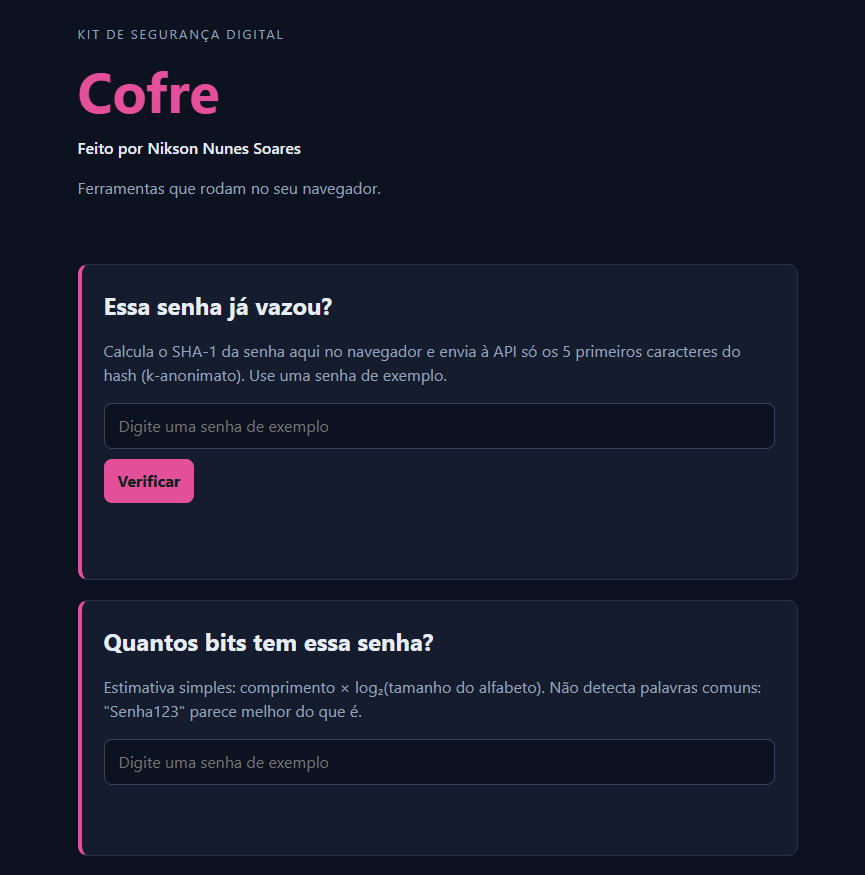

# Cofre: kit de segurança digital

**Veja funcionando:** https://epistacio.github.io/cofre/

## O que é

O Cofre é um kit de segurança digital feito em HTML, CSS e JavaScript. Ele verifica se uma senha já vazou e calcula a força dela, sem enviar a senha para a internet.

## Ferramentas

- **Essa senha já vazou?** Consulta uma base real de senhas vazadas sem enviar a senha (k-anonimato).
- **Quantos bits tem essa senha?** Estima a força da senha.
- **Esse link é suspeito?:** aponta sinais de golpe em um link, como falta de https, @ e endereço por IP

## O que eu aprendi

- Proteger senhas com .gitignore
- Usar issue e pull request
- Publicar site no GitHub Pages

## Tecnologias

HTML, CSS, JavaScript, Git, GitHub Pages e a API Pwned Passwords.

## Sobre o histórico

O histórico tem um arquivo `.env` com uma senha falsa, de propósito: foi um exercício para mostrar que apagar um arquivo não apaga o que já foi publicado no Git.

## Créditos

Código-base do Prof. Mario Rebello, na disciplina Introdução à Ciência da Computação (2026/2).
A ferramenta Esse link é suspeito? é de minha autoria. Licença MIT.
